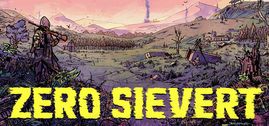

**ZERO Sievert by CABO Studio (2022) is a top-down STALKER-inspired extraction shooter.**

---

## 📖 About

ZERO Sievert by CABO Studio (2022) is a top-down STALKER-inspired extraction shooter. You enter irradiated zones, loot, complete missions, and extract before the radiation clock runs out. Its complexity comes from deep crafting, gear loadouts, and procedurally spawning threats.

## ⚠️ Problems Without Trainer

| Problem | Status |
|---------|--------|
| Radiation clock forces early extraction abandoning valuable loot mid-zone | ✅ Solved |
| Gear maintenance costs outpace mission rewards in mid-game progression | ✅ Solved |
| Random enemy spawn clusters surround extraction points without warning | ✅ Solved |
| Anomaly fields require anti-rad supplies that frequently run short | ✅ Solved |
| Vendor stock resets too slowly to keep up with gear degradation rate | ✅ Solved |

## ✅ Solution

The **ZERO Sievert Trainer** solves all these issues, giving you complete control so you can focus on enjoying the game.

## 🎯 Features

- Unlimited Resources / Currency
- God Mode / Invincibility
- Instant Skill & Ability Cooldown
- One-Hit Kill
- Freeze Timers
- Unlock All Items & Achievements
- Custom Speed Multiplier
- Infinite Stamina / Energy

## 🚀 Quick Start

1. **Disable Windows Defender** temporarily (trainer may trigger false positive)
2. Get the trainer from the button above
3. Launch ZERO Sievert
4. Run the trainer as Administrator
5. Use the hotkeys to activate cheats in-game

## 💎 Free vs Pro

| Feature | Free | Pro |
|---------|------|-----|
| God Mode | ✅ | ✅ |
| Unlimited Resources | ✅ | ✅ |
| Advanced Cheats | ❌ | ✅ |
| Auto-Updates | ❌ | ✅ |
| Priority Support | ❌ | ✅ |

## 💻 Requirements

- Windows 10 / 11 (64-bit)
- ZERO Sievert (any version)
- .NET Framework 4.8+
- DirectX 11+

## 🍎 macOS

## ⚖️ Legal

Educational and single-player use only.

---

